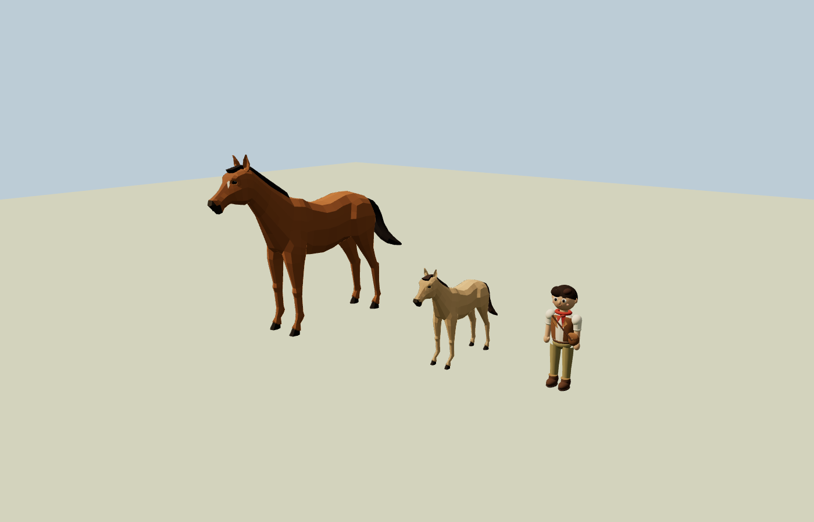

# Production characters

Issue #6 adds animated in-engine characters to the existing quest-owned groups. It does not replace movement, saves, interaction distances or camera ownership.

## Source and licensing

| Shipping asset | Verified source | License | Modifications |
| --- | --- | --- | --- |
| `public/assets/characters/horse.glb`, hero, foal and family herd | Quaternius, [Ultimate Animated Animal Pack](https://quaternius.com/packs/ultimateanimatedanimals.html), original `Horse.gltf` from the pack's linked public glTF folder | CC0 1.0, verified 13 October 2026 on the original pack page and actual downloaded `License.txt`; redistribution and modifications permitted; attribution optional | Original facial blaze, bay/dark-mane palette, distinct family coats, foal head/neck/trunk proportions, authored trot, trimmed harmful clips, jump root-motion correction, compact GLB |
| Alex geometry, rig, apple and animations | Original project artwork in `src/characters/alex.js` | Project MIT, see `LICENSE` | Authored curved clothing, scarf, expressive face, joint weights and six skeleton animation clips; retains the existing boy's identity |

The actual downloaded license is stored in `public/assets/licenses/quaternius-animals-license.txt`. `public/assets/licenses/characters.json` records original Drive file IDs, SHA256 hashes, source exporter, exact animation names, modifications and price. No payment or credit spend was used.

The official glTF folder contains `Horse.gltf` and `Horse_White.gltf`; only the verified brown horse is distributed here. The pack's source horse has 50 joints, 2182 triangles and 13 animations. The shipped file is 761,596 bytes, includes nine peaceful clips and needs no external textures or decoder. Runtime conversion combines its nine material primitives into one skinned draw call per horse. Each actor has an independent cloned skeleton; no family member can accidentally animate the hero.

The pack has no native trot. `prepare-horse.py` authors `Trot` by rephasing both hind-limb chains by one quarter of `Walk`, pairing diagonal limbs and shortening cadence to 0.78 seconds. It also limits the source jump's body-height displacement because the game already implements the jump trajectory. Source `Attack_*`, `Death` and `Idle_HitReact*` animations are not shipped.

## Integration

```js
import { attachCharacters } from './src/characters/characters.js';
const cast = attachCharacters({ THREE, horse, foal, herd, alex });
cast.ready.then(status => console.info('Characters', status));
// After all character movement and legacy procedural animation, before render:
cast.update(dt, { speed: P.speed, grounded: P.grounded, phase: G.phase });
```

The adapter loads `assets/characters/horse.glb` under Vite's configured base path. `assetUrl` can override the path for tests. Asset failure resolves a clear fallback status and keeps the original horse meshes visible. All parent groups, scales and existing `userData` quest/animation handles remain intact. `cast.dispose()` restores the fallback and releases new geometry/materials/skeleton textures.

Optional state: `gesture: 'graze' | 'sniff'`, `herdGesture`, `alexGesture: 'wave' | 'apple' | 'pet'`. Alex infers walking/running from displacement; meet+apple-offered automatically presents the apple, and reunion/finale gestures wave. Horse speed selects Idle, Walk, Trot or Gallop with a short crossfade. Airborne selects Gallop_Jump or Jump_toIdle and returns to locomotion after landing. Native Idle animates ears, breathing and tail. Neck counter-turn supplies a restrained glance during turns. Foal is smaller via its original parent scale and has a larger head, shorter neck and compact trunk in its own rig.

## Verification

Run `node --test src/characters/*.test.mjs`. Tests parse the actual shipping GLB through pinned Three.js r128, verify clip/joint data, independent skeletons, one skinned mesh per horse, foal proportions, locomotion/jump selection, original quest handles, fallback loading and reversible disposal. Alex tests verify skin weights, real skeleton deformation, apple-to-hand attachment and six animation states.

A separate Chromium WebGL render inspected hero, foal and Alex together, with five draw calls for the visible cast plus floor. The family lead has a pale dun coat and a slightly broader scale so it is recognizable in the reunion.



 This is browser rendering evidence, not actual iPad Safari verification. The release manual gate must check actual iPad frame rate, visual contacts on slopes, memory after chapter replay, Safari loading and jump transitions. The shader has no costly mobile shadow pass for horses; the world controls terrain contact visuals.
